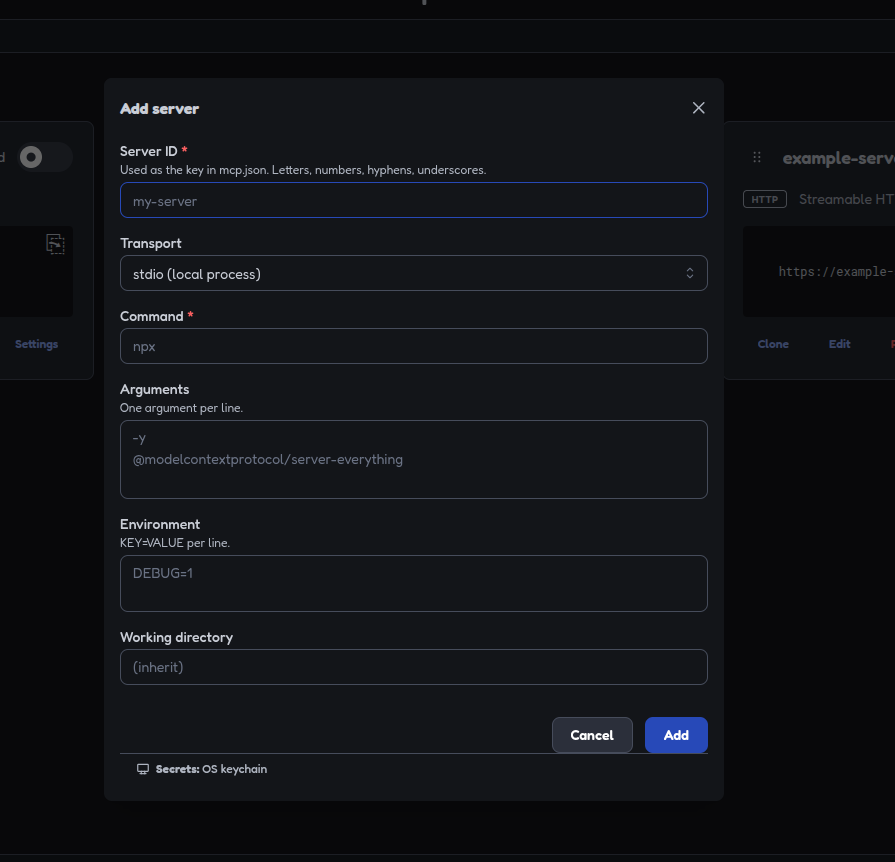
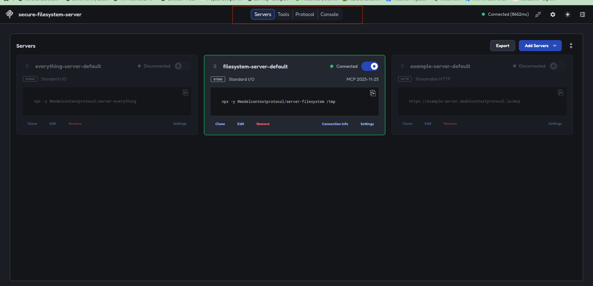

# Posts API MCP Server

MCP server that exposes a Posts & Comments REST API as tools, resources, and prompts.

## Project structure

```
apps/
├── api/                  # Express + MongoDB REST API (port 4002)
└── mcp/                  # MCP server (port 3001, POST /mcp)
    └── src/
        ├── tools/        # post + comment tools
        ├── resources/    # posts-api-guide resource
        ├── prompts/      # national-duty-post-workflow prompt
        └── server/       # McpServer factory
```

## Run

```bash
npm run api    # REST API on http://localhost:4002
npm run mcp    # MCP server on http://localhost:3001/mcp
```

## Using the registered prompt (`national-duty-post-workflow`)

You don't enter the prompt in server code — it's already registered in
`apps/mcp/src/prompts/index.js`. You use it from an **MCP client** connected
to your server:

### 1. opencode (configured via `opencode.json`)

1. Start your MCP server: `npm run mcp`
2. Run `opencode`, then type `/` — the prompt `national-duty-post-workflow`
   should appear in the prompt list
3. Select it and it injects the workflow into the chat

### 2. MCP Inspector

1. Open https://mcp.ziziyi.com/inspector
2. Connect to `http://localhost:3001/mcp`
3. Go to the **Prompts** tab and select/run `national-duty-post-workflow`

### 3. Cursor / Claude Desktop

1. Add your MCP server to the client config
2. Invoke the prompt via `/national-duty-post-workflow` in their chat

Clients fetch prompts via the `prompts/list` and `prompts/get` JSON-RPC
methods — the entry point is always the client's chat UI, not the server.


### see the lists of mcps
```bash
opencode mcp list
```

### check mcp if up after running `npm run mcp`
```bash

opencode mcp list
curl -i http://localhost:3001/mcp

curl -i -X POST http://localhost:3001/mcp \
 -H "Content-Type: application/json" \
 -H "Accept: application/json, text/event-stream" \
 -d '{"jsonrpc":"2.0","id":1,"method":"tools/list"}' 

```

Or open
```bash
npx @modelcontextprotocol/inspector

#or

npx @modelcontextprotocol/inspector --cli http://localhost:3001/mcp --method tools/list

```
CLICK on add servers first:



Then connect:





- All u say is fine if developer go and prompt in the chat but how a html ui will
communicate here I'm confused please put a video bro❤ 

 - Waiting for the authentication part and the session generator process 
