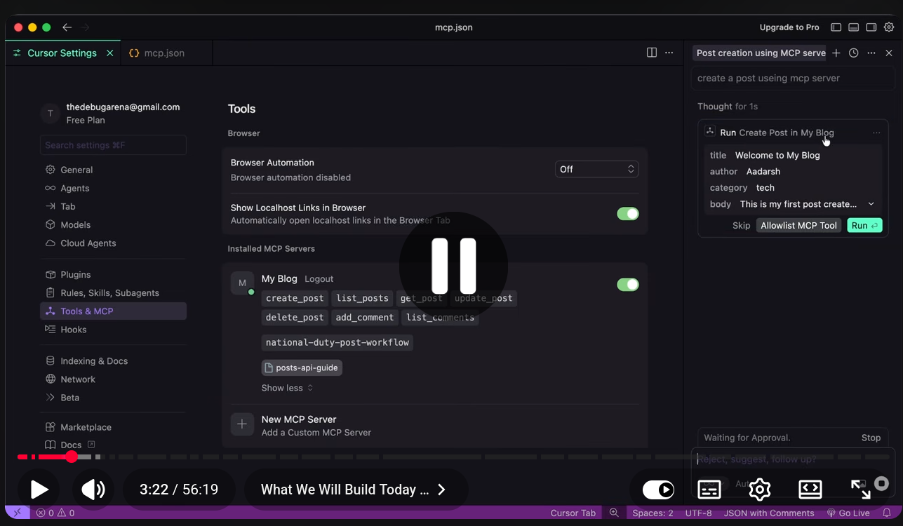
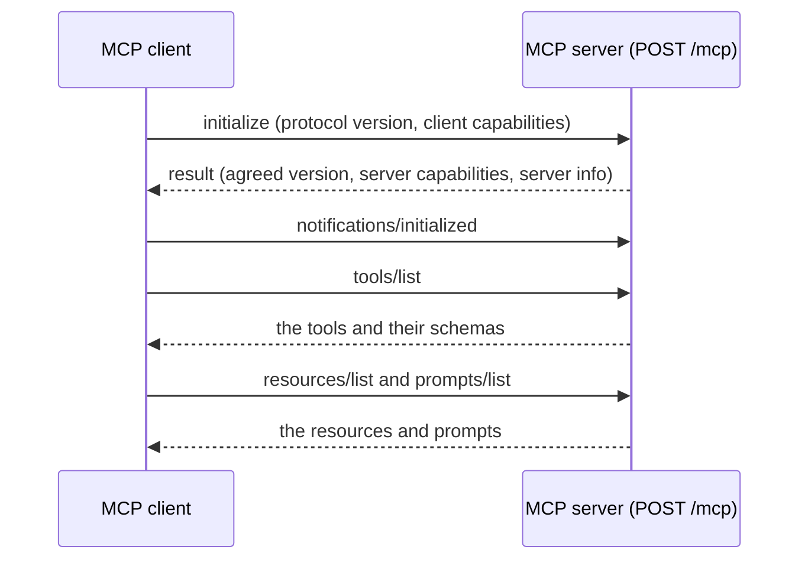
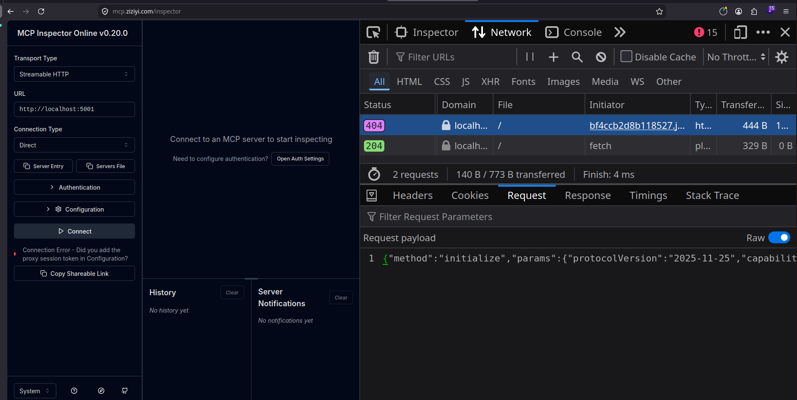
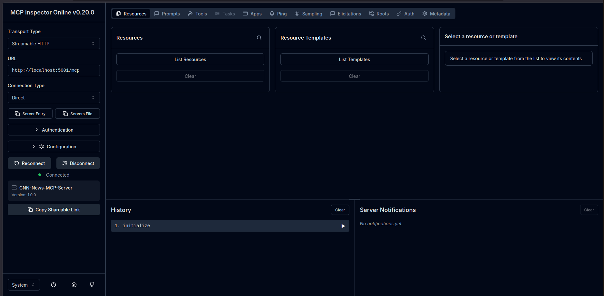
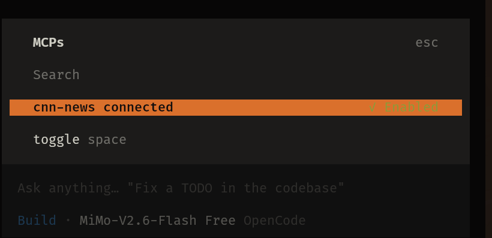
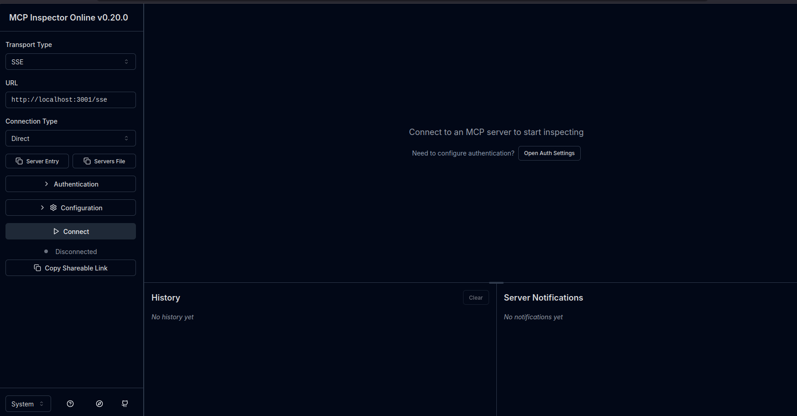

# Posts API MCP Server

An MCP server that exposes a Posts and Comments REST API to AI clients as tools, resources, and prompts. This README also doubles as a set of study notes on how MCP works.

## Contents

1. [Why MCP exists](#1-why-mcp-exists)
2. [Key terms](#2-key-terms)
3. [Tools, resources, and prompts](#3-tools-resources-and-prompts)
4. [Message format: JSON-RPC](#4-message-format-json-rpc)
5. [Transports](#5-transports)
6. [The handshake: what happens when you enter the MCP URL](#6-the-handshake-what-happens-when-you-enter-the-mcp-url)
7. [Full request lifecycle](#7-full-request-lifecycle)
8. [Building a server in Node.js](#8-building-a-server-in-nodejs)
9. [This repository](#9-this-repository)
10. [Connecting with OpenCode](#10-connecting-with-opencode)
11. [Testing with MCP Inspector](#11-testing-with-mcp-inspector)
12. [Using the registered prompt](#12-using-the-registered-prompt)

---

## 1. Why MCP exists

A large language model (LLM) can only produce text. On its own it cannot read
your database, call your API, or change anything in the outside world. To make
it useful for real work, something has to connect it to those systems.

The Model Context Protocol (MCP) is an open standard that defines how an AI
application talks to external programs. Instead of writing a custom integration
for every model and every app, you build one MCP server, and any MCP-capable
client can use it.

In short: the model decides what should happen, and MCP gives it a safe, structured way to make it happen.

## 2. Key terms

| Term            | Meaning                                                                                                              |
| --------------- | -------------------------------------------------------------------------------------------------------------------- |
| **Model (LLM)** | The "brain", for example Claude, ChatGPT, or Gemini. It reasons about the request and decides when a tool is needed. |
| **Host**        | The application the user actually works in, such as Cursor, OpenCode, or Claude Desktop.                             |
| **MCP client**  | The part of the host that speaks MCP. It opens a connection to a server and relays messages.                         |
| **MCP server**  | Your program (here, an Express app) that exposes capabilities and carries out actions.                               |
| **Agent**       | A model plus the ability to choose and call tools on its own to finish a task.                                       |

Many MCP clients are free to use, including Cursor, OpenCode, Claude Desktop, and the official MCP Inspector.

## 3. Tools, resources, and prompts

A server can offer three kinds of capability.

### Tools

Tools are functions the model can call to do something, for example `get_posts` or `create_post`. Each tool declares:

- a **name**
- a **description** the model reads to decide when to use it
- an **input schema** (the parameters it accepts)
- optionally, an **output structure**

### Resources

Resources are read-only pieces of information the server makes available as context, such as documents, files, or reference data. In this project, the `posts-api-guide` resource describes how the Posts API works, so the model can read it before acting.

Resources inform; tools act.

### Prompts

Prompts are reusable, ready-made message templates published by the server. A user picks one in the client, and it inserts a prepared set of instructions into the chat. They differ from a system prompt, which is written by the developer or user of the client. Many clients let you start one with a slash command, though exact behavior depends on the client.

## 4. Message format: JSON-RPC

Client and server exchange messages in JSON-RPC 2.0, a lightweight format where every request has a `method`, optional `params`, and an `id` that the response repeats.

**Request: calling a tool**

```json
{
  "jsonrpc": "2.0",
  "id": 1,
  "method": "tools/call",
  "params": {
    "name": "get_users",
    "arguments": {}
  }
}
```

**Response**

```json
{
  "jsonrpc": "2.0",
  "id": 1,
  "result": {
    "content": [
      {
        "type": "text",
        "text": "[{\"name\":\"John\",\"age\":30},{\"name\":\"Jane\",\"age\":25}]"
      }
    ]
  }
}
```

Tool results come back as a `content` array. Plain data is usually serialized into a text block, as shown above.



## 5. Transports

JSON-RPC defines the language. The transport defines how those messages travel.

| Transport           | Use                                                                                                                                                                  |
| ------------------- | -------------------------------------------------------------------------------------------------------------------------------------------------------------------- |
| **stdio**           | The client launches the server as a local process and talks over standard input and output.                                                                          |
| **Streamable HTTP** | The current standard for remote or HTTP-based servers. The client sends a `POST`, and the server replies with plain JSON or streams the reply. This project uses it. |
| **HTTP + SSE**      | The older approach, in which the server pushes events one way over Server-Sent Events. It has been superseded by Streamable HTTP.                                    |

## 6. The handshake: what happens when you enter the MCP URL

The URL is the starting point of every connection. You enter it in one place or
another, depending on the client:

| Client                  | Where the URL goes                          |
| ----------------------- | ------------------------------------------- |
| MCP Inspector           | The **URL** field, followed by **Connect**  |
| OpenCode                | The `url` field in `opencode.json`          |
| Cursor / Claude Desktop | The server entry in the client's MCP config |

Once the client has the URL, it does not call any tools right away. It first performs a handshake so both sides agree on what they support.



### Step 1: the client sends `initialize`

This is always the first message. It states which protocol version the client speaks and what features it supports.

```json
{
  "jsonrpc": "2.0",
  "id": 0,
  "method": "initialize",
  "params": {
    "protocolVersion": "2025-11-25",
    "capabilities": {
      "sampling": {},
      "elicitation": {},
      "roots": { "listChanged": true }
    },
    "clientInfo": {
      "name": "inspector-client",
      "version": "0.20.0"
    }
  }
}
```

The version string and capability list differ from client to client. Treat the values above as an example, not a fixed requirement.



### Step 2: the server answers

The server replies with the protocol version it will use, the capabilities it offers, and information about itself.

```json
{
  "jsonrpc": "2.0",
  "id": 0,
  "result": {
    "protocolVersion": "2025-11-25",
    "capabilities": {
      "tools": {},
      "resources": {},
      "prompts": {}
    },
    "serverInfo": {
      "name": "posts-api",
      "version": "1.0.0"
    }
  }
}
```

The `capabilities` block is what tells the client to go ahead and ask for tools, resources, and prompts.

### Step 3: the client confirms

The client sends a `notifications/initialized` message. This is a notification, so it has no `id` and expects no reply. The connection is now ready.

### Step 4: discovery

Next, the client lists what the server offers:

- `tools/list` returns every tool with its schema (this is what you see in the Inspector's **Tools** tab)
- `resources/list` returns the available resources
- `prompts/list` returns the available prompts

### Note on stateless mode

This project runs the server in stateless mode (`sessionIdGenerator: undefined`). The server does not issue a session ID, and each `POST /mcp` request is handled by a fresh server instance. The handshake still takes place from the client's point of view. Requests to this endpoint need the header `Accept: application/json, text/event-stream`, and a plain browser GET to `/mcp` is rejected with `405`.

If the handshake fails, the client reports the server as not connected. For example, OpenCode shows `failed` in `opencode mcp list` when it cannot reach the URL at all.

## 7. Full request lifecycle

Here is everything that happens from the moment a user types a request to the moment they see an answer.

1. The user types a request in the client, for example "create a post about local elections".
2. The client sends the request to the model, along with the list of available tools.
3. The model works out what the user wants.
4. The model decides a tool is needed and emits a tool call with a name and arguments.
5. The client wraps that call as a JSON-RPC `tools/call` request.
6. The client sends it to the MCP server.
7. The server checks the arguments against the tool's input schema.
8. The server runs the tool. In this project, that means calling the REST API.
9. The server returns a structured result, either as a plain response or as a stream.
10. The client passes the result back to the model.
11. The model continues reasoning, and may call more tools.
12. The final answer appears in the client.

## 8. Building a server in Node.js

A minimal stateless server using the official SDK and Express:

```js
import express from "express";
import cors from "cors";
import { McpServer } from "@modelcontextprotocol/sdk/server/mcp.js";
import { StreamableHTTPServerTransport } from "@modelcontextprotocol/sdk/server/streamableHttp.js";

const app = express();

app.use(cors());
app.use(express.json()); // parses the body so it can be passed to handleRequest

function createMCPServer() {
  const server = new McpServer(
    { name: "CNN-News-MCP-Server", version: "1.0.0" },
    { capabilities: { tools: {}, resources: {}, prompts: {} } },
  );

  // Register tools, resources, and prompts here, for example:
  // server.tool("get-headlines", "Get latest headlines", {}, async () => ({
  //   content: [{ type: "text", text: "..." }],
  // }));
  // Newer SDK versions also provide registerTool.

  return server;
}

app.post("/mcp", async (req, res) => {
  const server = createMCPServer();
  const transport = new StreamableHTTPServerTransport({
    sessionIdGenerator: undefined, // stateless mode
  });

  res.on("close", () => {
    transport.close().catch(() => {});
    server.close().catch(() => {});
  });

  try {
    await server.connect(transport);
    await transport.handleRequest(req, res, req.body);
  } catch (error) {
    console.error(error);
    if (!res.headersSent) {
      res.status(500).json({
        jsonrpc: "2.0",
        error: { code: -32603, message: "Internal server error" },
        id: null,
      });
    }
  }
});

// Stateless mode does not support GET or DELETE
app.get("/mcp", (req, res) => {
  res.status(405).json({
    jsonrpc: "2.0",
    error: { code: -32000, message: "Method not allowed." },
    id: null,
  });
});

app.listen(5001, () => {
  console.log("MCP server listening on port 5001");
});
```



## 9. This repository

The standalone example above is split into two apps to keep responsibilities separate.

```
apps/
├── api/                  # Express + MongoDB REST API (port 4002)
│   └── src/
│       ├── config/       # environment config (PORT, MONGO_URI)
│       ├── models/       # Post and Comment Mongoose schemas
│       ├── validations/  # pure validation functions
│       ├── services/     # business logic (throws HttpError)
│       ├── controllers/  # request handlers
│       ├── routes/       # /posts and nested /posts/:id/comments
│       ├── middleware/   # 404 and central error handler
│       ├── app.js        # Express app assembly
│       └── server.js     # database connection and listen
└── mcp/                  # MCP server (port 3001, POST /mcp)
    └── src/
        ├── config/       # MCP_PORT, API_BASE_URL
        ├── client/       # fetch wrapper that calls the REST API
        ├── validators/   # same rules as the API
        ├── tools/        # post.tools.js and comment.tools.js (7 tools)
        ├── resources/    # posts-api-guide resource
        ├── prompts/      # national-duty-post-workflow prompt
        ├── server/       # McpServer factory (registers everything)
        ├── app.js        # stateless Streamable HTTP /mcp endpoint
        └── server.js     # entry point
```

Run both from the repo root, each in its own terminal:

```bash
npm run api    # REST API on http://localhost:4002
npm run mcp    # MCP server on http://localhost:3001/mcp
```

Request flow:

```
MCP client -> POST /mcp (apps/mcp) -> apiClient -> REST API (apps/api) -> MongoDB
```

## 10. Connecting with OpenCode

Create `opencode.json` in the project root:

```json
{
  "$schema": "https://opencode.ai/config.json",
  "mcp": {
    "posts-api": {
      "type": "remote",
      "url": "http://localhost:3001/mcp",
      "enabled": true
    }
  }
}
```

Start the MCP server first (`npm run mcp`), then check the connection:

```bash
opencode mcp list
```

A healthy server shows as connected. If it shows `failed` with a connection error, the server is not running, the port is wrong, or the URL path does not match.

To use it, start `opencode` and run `/mcp` to see the connected servers.



## 11. Testing with MCP Inspector

The official Inspector lets you connect to your server and look at everything it exposes.

1. Start the MCP server and leave it running:

   ```bash
   npm run mcp
   ```

2. In a second terminal, start the Inspector:

   ```bash
   npx @modelcontextprotocol/inspector
   ```

3. Open the URL it prints (usually `http://localhost:6274`).
4. Set **Transport Type** to **Streamable HTTP**.
5. Enter `http://localhost:3001/mcp` in the **URL** field.
6. Click **Connect**. This is where the handshake from [section 6](#6-the-handshake-what-happens-when-you-enter-the-mcp-url) runs. The initialize exchange appears in the history panel.
7. Use the tabs at the top:
   - **Tools**, then **List Tools**, shows all tools and their schemas, and lets you run them
   - **Resources** shows `posts-api-guide`
   - **Prompts** shows `national-duty-post-workflow`

For a quick check from the command line, `curl -i http://localhost:3001/mcp` should return a `405`. That response means the server is up, since this endpoint only accepts `POST`.



## 12. Using the registered prompt

The prompt `national-duty-post-workflow` is registered in `apps/mcp/src/prompts/index.js`. You do not run it from server code. You pick it from a client that is connected to the server. Clients load prompts with the `prompts/list` and `prompts/get` methods.

- **MCP Inspector:** open the **Prompts** tab, select the prompt, and run it.
- **OpenCode, Cursor, Claude Desktop:** connect the server, then look for the prompt in the client's prompt or slash-command menu. Support for MCP prompts varies by client, so confirm it in yours.

A normal request that uses the tools might look like this:

> Create a post using the posts-api MCP server.

Here `posts-api` is the name given to the server in the client's config. It is not a resource.
